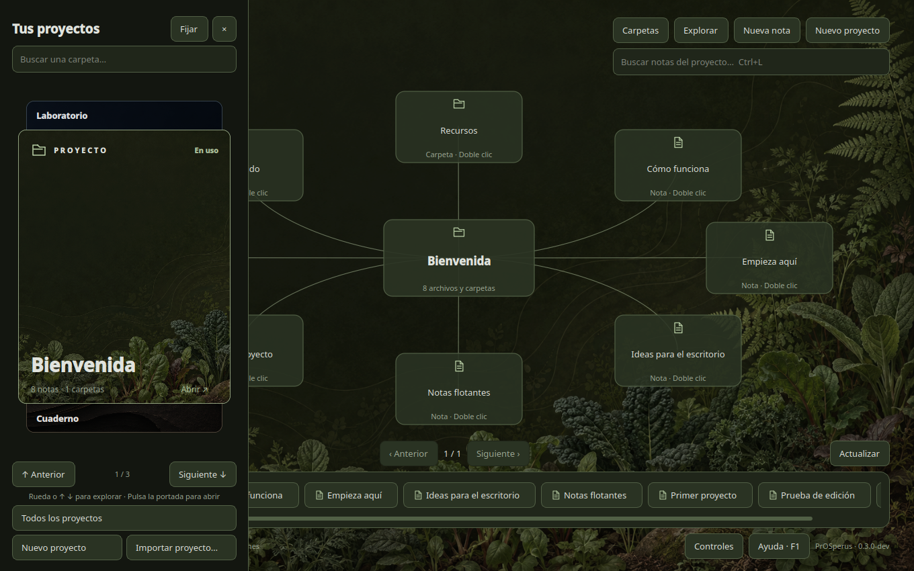

# PrOSperus desktop

**Un escritorio Linux organizado por proyectos.** Cada carpeta es un escritorio:
un mapa con sus notas y subcarpetas, su propio fondo y paleta, notas flotantes
y una barra con lo que tienes abierto. Las aplicaciones se reparten solas en
pantalla (Fibonacci) sobre ese mapa.



**Versión actual: 0.5.0** (en desarrollo hacia la [1.0](docs/CHECKLIST-1.0.md)).
Probado en máquinas virtuales y en el portátil del autor; falta probarlo en
más equipos. No lo uses aún como sistema principal ni con datos sin copia de seguridad.

> [!WARNING]
> **No es seguro para uso diario.** El núcleo Linux está fijado y no recibe
> actualizaciones de seguridad, y PrOSperus no tiene todavía forma de actualizarse
> sin reinstalar. Tampoco admite Secure Boot. No lo uses en equipos con datos
> sensibles ni en redes que no controles, y no lo instales en un equipo de trabajo
> sin el permiso de quien lo administra.

## Qué hace

- **Proyectos:** tarjetero (o cuadrícula) para elegir proyecto; crear proyectos
  nuevos o importar carpetas existentes sin modificar los originales.
- **Mapa:** las notas y subcarpetas de la carpeta actual alrededor del centro.
  Se navega con ratón, flechas, Tab e Intro; Esc vuelve atrás.
- **Notas:** ventanas flotantes con edición Markdown, bloques de código y gráficas;
  guardado explícito y aviso si el archivo cambió fuera.
- **Archivos:** crear, copiar, pegar, duplicar, arrastrar desde otro gestor,
  renombrar (actualizando enlaces), papelera recuperable, ocultar carpetas,
  abrir con otra aplicación.
- **Búsqueda:** por nombre y por el contenido de las notas, sin distinguir tildes.
- **Ventanas (Sway):** distribución Fibonacci, columnas o principal centrada,
  perfiles para 21:9 y 32:9, Alt+Tab con apps y notas, varios monitores.
- **Sistema:** Aplicaciones (Ctrl+Espacio), Instalar programas (apt y Flathub),
  controladores NVIDIA, red, sonido, brillo, bloqueo de pantalla (Super+L),
  reloj con agenda. F1 abre la ayuda.

## Probarlo

La forma recomendada es la **ISO Live sobre Debian 13**, que también trae un
instalador a disco junto a otro sistema (dual boot).

```bash
bash scripts/build-iso-debian.sh                 # construye out/iso-debian/
bash scripts/write-usb.sh out/iso-debian/prosperus-live-x86_64.iso /dev/sdX
                                                 # graba en USB con persistencia (¡borra el USB!)
```

- [Guía de la versión Debian](docs/DEBIAN.md)
- [Instalar en disco junto a otro sistema](docs/DUAL-BOOT.md)
- [Persistencia en el USB](docs/PERSISTENCIA.md)

La última ISO publicada es antigua ([v0.3.2-live.1](https://github.com/harasmeant/PrOSperus-desktop/releases/tag/v0.3.2-live.1),
Fedora con Cage): no incluye nada de lo de 0.4 y 0.5. Hay también recetas
experimentales para [Arch](docs/ARCH.md) y Fedora (`scripts/build-iso.sh`), que
comparten el mismo escritorio.

### Solo el escritorio, sin ISO

Necesita Python 3 con PySide6 y PyGObject:

```bash
bash desktop/iniciar.sh --root demo-system      # proyectos de ejemplo
```

Sin Sway funciona el mapa, las notas y los proyectos; la gestión de ventanas
reales necesita una sesión Sway/SwayFX.

## Desarrollo

```bash
QT_QPA_PLATFORM=offscreen PYTHONPATH=desktop python3 -m unittest discover -s tests
```

- `desktop/prosperus/`: el escritorio (Python/Qt).
- `image/`: recetas de las imágenes (`debian/`, `arch/`, Fedora en la raíz) y `rootfs/` compartido.
- `scripts/`: construir ISO, grabar USB, probar en QEMU.
- `tests/`: pruebas automáticas; [PRUEBAS-MINIMAS.md](docs/PRUEBAS-MINIMAS.md) recoge las manuales.
- `prototype/obsidian/`: el prototipo original como complemento de Obsidian (versión 0.0).

Historial en [CHANGELOG.md](CHANGELOG.md), hoja de ruta en [ROADMAP.md](docs/ROADMAP.md)
y decisiones en el [diario de trabajo](docs/WORKLOG.md). Para contribuir, [CONTRIBUTING.md](CONTRIBUTING.md).

## Límites conocidos

- Probado en un solo equipo real; sin Secure Boot (ni la ISO ni el instalado están firmados).
- El núcleo está fijado: no recibe parches de seguridad (ver el aviso de arriba).
- Mover una nota a otra carpeta no actualiza sus enlaces relativos (renombrar sí).
- Las ventanas no recuperan su disposición tras reiniciar.
- No hay aislamiento entre proyectos: los favoritos y permisos son globales.

## Autor y licencia

**Autor:** [Nicolás · harasmeant](https://github.com/harasmeant). Desarrollo iterativo con asistencia de IA.

Copyright (C) 2026 Nicolás (harasmeant). Distribuido bajo la **GNU General Public
License, versión 3 exclusivamente** (`GPL-3.0-only`); texto completo en [LICENSE](LICENSE).
Puedes usar, estudiar, modificar y redistribuir el proyecto; si distribuyes una
versión derivada, debe seguir bajo GPLv3 con su código fuente. Sin garantía.
Los componentes de terceros (Debian, Sway/SwayFX, Qt, aplicaciones del sistema)
conservan sus propias licencias.

---

**English:** PrOSperus is a project-oriented Linux desktop. Each folder becomes a
workspace with a map of its notes, its own wallpaper and palette, floating Markdown
notes and automatic Fibonacci tiling of real applications on Sway. The main build is
a Debian 13 Live ISO with USB persistence and a dual-boot installer. Version 0.5.0,
tested in virtual machines only; not yet ready for daily use.
