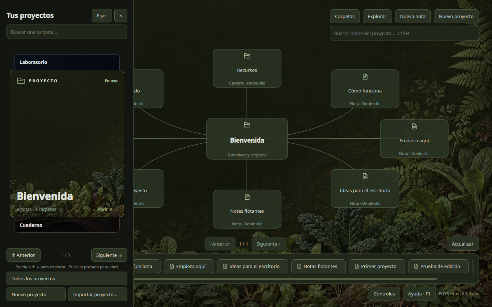

# PrOSperus desktop

**PrOSperus desktop · Prototipo de escritorio orientado a proyectos**

## Escritorio independiente en desarrollo · 0.3.2-dev

La carpeta `desktop/` contiene una aplicación Python/Qt independiente de Obsidian.
Esta iteración recupera el aspecto del prototipo aceptado: wallpapers heredados,
paletas por proyecto, tarjetero vertical, mapa radial, notas flotantes y barra
contextual. Incluye edición Markdown y guardado, creación de notas/carpetas,
explorador y buscador de aplicaciones Linux con favoritos globales.
Ahora también permite crear e importar proyectos, seleccionar y copiar notas o
carpetas, pegar desde el gestor de archivos, duplicar y usar atajos de escritorio.
F1 muestra la ayuda; Ctrl+Espacio abre Aplicaciones en la demo de Fedora.
Los buscadores del mapa, el explorador y el tarjetero consultan tanto los
nombres como el contenido guardado de los Markdown, incluidas las subcarpetas.

[Descargar la demo v0.3.2-dev](https://github.com/harasmeant/PrOSperus-desktop/releases/tag/v0.3.2-dev).
Descarga `prosperus-demo-v3.2.tar.gz`; la publicación conserva también los paquetes
v3 y v3.1 como histórico.

La [ISO Live de prueba](https://github.com/harasmeant/PrOSperus-desktop/releases/tag/v0.3.2-live.1)
incluye las dependencias y arranca directamente en PrOSperus. Comprobada con
UEFI, dos CPU y 2 GiB en QEMU; sin instalador ni persistencia. Consulta la
[guía de la ISO](docs/ISO-LIVE.md).

Para probarla dentro de Fedora, consulta [la guía de la demo](docs/FEDORA-DEMO.md).
El [diario de trabajo](docs/WORKLOG.md) registra la referencia acordada, los cambios
y sus límites. No se ha alcanzado la paridad completa con el complemento de
Obsidian; tampoco se ha validado una distribución para uso diario.

## Referencia original · versión 0.0

Un proyecto para organizar el trabajo en Linux alrededor de carpetas, notas y aplicaciones. Cada carpeta se convierte en un escritorio visual con un mapa navegable, notas flotantes y una barra de tareas contextual.

La versión **0.0** conserva el prototipo funcional desarrollado como complemento de Obsidian y establece el punto de partida para una futura distribución Linux. Esa versión publicada no incluye una ISO, una imagen de sistema ni un escritorio independiente; el desarrollo local posterior se describe arriba.

## Lo que ya funciona

- Escritorio por carpeta con mapa de archivos y subcarpetas.
- Selector lateral de proyectos, búsqueda y navegación por teclado.
- Notas flotantes mediante Hover Editor, minimización y recuperación durante la sesión.
- Explorador de la bóveda: crear, buscar, mover, renombrar y eliminar con las API de Obsidian.
- Fondos heredados por subcarpetas y paletas por proyecto.
- Buscador de aplicaciones Linux y favoritos globales; lanzamiento mediante GIO.
- Apertura de archivos Python en VSCodium mediante su protocolo de escritorio.

## Qué demuestra este proyecto

Diseño de una interfaz de trabajo, desarrollo en JavaScript y CSS, integración con aplicaciones Linux mediante Python/GIO, gestión de archivos y validación automatizada. La evolución hacia un escritorio independiente exige separar la interfaz, el motor de archivos y enlaces, la integración con Linux y la construcción de la imagen.

**Autor:** [Nicolás · harasmeant](https://github.com/harasmeant). Desarrollo iterativo con asistencia de IA. Las funciones implementadas y las propuestas futuras están documentadas por separado.

## Probar la versión 0.0

Consulta la [guía de instalación](docs/INSTALL.md). El complemento no necesita compilación. Se incluyen notas ficticias en `demo/` para explorarlo sin usar documentos personales.

## Estructura

- [`prototype/obsidian/`](prototype/obsidian/): código del prototipo y pruebas del lanzador.
- [`demo/`](demo/): pequeñas carpetas y notas de ejemplo.
- [`docs/ROADMAP.md`](docs/ROADMAP.md): alcance de la futura distro y siguientes hitos.
- [`docs/VALIDATION.md`](docs/VALIDATION.md): comprobaciones y límites de la evidencia.
- [`docs/BASELINE.md`](docs/BASELINE.md): procedencia del estado 0.0 y ajustes para publicarlo.
- [`CHANGELOG.md`](CHANGELOG.md): historial de versiones.

## Límites actuales

El prototipo depende de Obsidian y Hover Editor. El mapa representa la estructura de archivos, no un grafo semántico. La disposición de las ventanas no se recupera automáticamente tras reiniciar. Los favoritos de aplicaciones son globales y no existe aislamiento por proyecto. La base Linux y el toolkit del escritorio futuro siguen pendientes de elección.

## Licencia

Copyright (C) 2026 Nicolás (harasmeant).

PrOSperus desktop se distribuye bajo la **GNU General Public License, versión 3 exclusivamente** (`GPL-3.0-only`). Consulta el texto completo en [LICENSE](LICENSE). Esta licencia cubre el código y el material original de este repositorio, incluido el prototipo propio publicado en `v0.0`, salvo indicación expresa en un archivo.

Puedes usar, estudiar, modificar y redistribuir el proyecto. Si distribuyes una versión derivada cubierta por esta licencia, debes mantener GPLv3 y facilitar el código fuente correspondiente conforme a sus condiciones. El software se ofrece sin garantía, según la licencia.

Las modificaciones privadas no obligan a publicar un fork ni a enviar cambios a este repositorio. Nicolás decide qué contribuciones incorpora al proyecto oficial; consulta [CONTRIBUTING.md](CONTRIBUTING.md).

Los componentes de terceros conservan sus propias licencias. Obsidian, Hover Editor y las aplicaciones del sistema son dependencias externas y no se redistribuyen aquí. Esta elección no cambia la licencia de los componentes de una futura imagen Linux.

Referencia: [GPLv3, condiciones de distribución](https://www.gnu.org/licenses/gpl-3.0.en.html).

---

**English:** PrOSperus desktop is a project-oriented Linux desktop experiment. Version 0.0 contains a working Obsidian prototype with folder maps, floating notes, a vault explorer and a Linux application launcher. A standalone desktop and a bootable Linux image are planned, not yet implemented.
