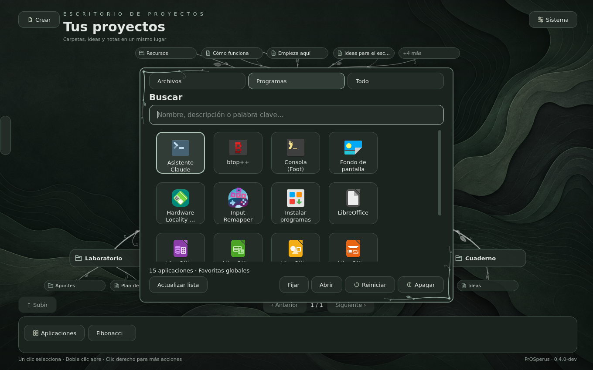

# PrOSperus sobre Arch Linux

**Estado al 04-11-2026:** arranque UEFI, sesión SwayFX, Aplicaciones y búsqueda
en Instalar programas (pacman y Flathub) comprobados en QEMU/KVM con 2 GiB, sin red.
No probado todavía en hardware real ni la instalación de paquetes con red.

La misma ISO Live (escritorio, Sway/SwayFX, persistencia en USB), construida
sobre Arch Linux en vez de Fedora. Sin repositorios de Red Hat: paquetes de los
repositorios oficiales de Arch y, para SwayFX e Input Remapper, del AUR.



## Construir y probar

```bash
bash scripts/build-iso-arch.sh
PROSPERUS_ISO_DIR=out/iso-arch PROSPERUS_TOOLS=localhost/prosperus-arch-tools:dev \
PROSPERUS_VM_NAME=prosperus-arch-vm PROSPERUS_VNC_PORT=5904 bash scripts/run-iso.sh
```

La ISO queda en `out/iso-arch/prosperus-live-x86_64.iso`, con su SHA-256 y el
inventario `packages.txt`. Se graba en un USB igual que la de Fedora
(`scripts/write-usb.sh`). Las variables de `run-iso.sh` permiten tener a la vez
la VM de Fedora (puerto VNC 5903) y la de Arch (5904).

## Qué cambia respecto a Fedora

| | Fedora | Arch |
|---|---|---|
| Recetas | `image/Containerfile*` | `image/arch/Containerfile*` |
| Paquetes | `dnf5`, `.rpm` | `pacman -Syu`, `.pkg.tar.zst` |
| SwayFX | COPR | AUR, compilado en una etapa aparte (sin dejar `base-devel` en el sistema) |
| Input Remapper | repositorio Fedora | AUR, igual que SwayFX |
| Arranque Live | `dracut-live` | `dracut` de Arch (ya incluye `dmsquash-live`) |
| NVIDIA | RPM Fusion + akmods | `nvidia-open-dkms` del repositorio oficial |
| Núcleo fijo | `excludepkgs` en dnf.conf | `IgnorePkg = linux linux-headers` |

El escritorio detecta el sistema leyendo `/etc/os-release`
(`desktop/prosperus/distro.py`): Instalar programas, el asistente de
controladores y los mensajes de dependencias usan pacman en Arch y dnf en Fedora.

## Pendiente de probar

Falta probar los dos sistemas (Arch y Fedora) en hardware real, y en Arch
también la instalación de paquetes con red, el controlador NVIDIA y la
persistencia en USB. La lista completa está en [PRUEBAS-MINIMAS.md](PRUEBAS-MINIMAS.md).

## Límites

- Los paquetes del AUR y de Arch no están fijados por versión: cada construcción
  toma lo último publicado.
- Instalar con pacman actualiza también el resto del sistema (`-Syu`), porque
  Arch no admite actualizaciones parciales. Sin la capa persistente del USB,
  lo instalado se pierde al apagar.
- NVIDIA en la Live: el núcleo de la ISO no se actualiza, así que el asistente
  descarga sus cabeceras exactas del archivo histórico de Arch
  (archive.archlinux.org) antes de compilar el módulo con DKMS.
  No se ha probado todavía en hardware con NVIDIA.
