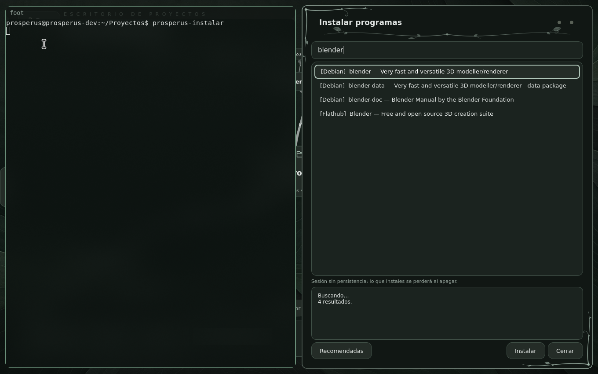

# PrOSperus sobre Debian

**Estado al 04-11-2026:** arranque UEFI, sesión SwayFX, Aplicaciones, consola y
búsqueda en Instalar programas (apt y Flathub) comprobados en QEMU/KVM con 2 GiB,
sin red. No probado todavía en hardware real ni la instalación de paquetes con red.

La misma ISO Live (escritorio, SwayFX, persistencia en USB), construida sobre
**Debian 13 «trixie» estable**. Es la versión conservadora: paquetes probados
y sin sorpresas, a cambio de versiones algo más antiguas que en Fedora o Arch.



## Construir y probar

```bash
bash scripts/build-iso-debian.sh
PROSPERUS_ISO_DIR=out/iso-debian PROSPERUS_TOOLS=localhost/prosperus-debian-tools:dev \
PROSPERUS_VM_NAME=prosperus-debian-vm PROSPERUS_VNC_PORT=5905 bash scripts/run-iso.sh
```

La ISO queda en `out/iso-debian/prosperus-live-x86_64.iso`, con su SHA-256 y
el inventario `packages.txt`. Se graba en un USB igual que las demás
(`scripts/write-usb.sh`). Puede convivir con la VM de Fedora (puerto VNC 5903)
y la de Arch (5904).

## Qué cambia respecto a Fedora y Arch

| | Fedora | Arch | Debian |
|---|---|---|---|
| Recetas | `image/Containerfile*` | `image/arch/Containerfile*` | `image/debian/Containerfile*` |
| Ritmo | semestral | continuo | estable cada ~2 años |
| Paquetes | `dnf5`, `.rpm` | `pacman -Syu`, `.pkg.tar.zst` | `apt`, `.deb` |
| SwayFX | COPR (0.6) | AUR (0.6) | compilado en la receta: SwayFX 0.5.3 + SceneFX 0.4.1 + wlroots 0.19.2, fijados por commit |
| Input Remapper | Fedora | AUR | Debian |
| Arranque Live | `dracut-live` | `dracut` | `dracut` + `dracut-live` (sustituyen a initramfs-tools) |
| NVIDIA | RPM Fusion + akmods | `nvidia-open-dkms` | `nvidia-open-kernel-dkms` (non-free) |
| Núcleo fijo | `excludepkgs` | `IgnorePkg` | `apt-mark hold` |
| Tema GTK adw-gtk3 | Fedora | Arch | descargado y fijado por SHA-256 |

SwayFX no está en Debian. Se compila en una etapa aparte, con su propia
wlroots 0.19 (trixie trae la 0.18), y no deja compiladores en el sistema.
SwayFX 0.5.1, la última para wlroots 0.18, dejaba recuadros sin repintar al abrir
ventanas. La 0.6 de Fedora y Arch necesita wlroots 0.20, que pide libdrm y
xkbcommon más nuevos que los de trixie. El binario del paquete `sway` se aparta
con `dpkg-divert` para que una actualización no lo sustituya.

Otras diferencias de versión que el escritorio ya tiene en cuenta
(`theme_state.py`, `prosperus-osd`):

- wob 0.14 no admite estilos: con el sonido silenciado, la barra sale vacía.
- foot 1.21 llama `[colors]` a lo que 1.22 llama `[colors-dark]`.
- Qt no dibuja iconos SVG sin `qt6-svg-plugins`, que Debian no instala por
  defecto con PySide6.
- El servicio de Input Remapper se llama `input-remapper-daemon`.
- Debian regenera el initramfs de cada `/boot/vmlinuz-*` al instalar firmware;
  ese paso se desactiva porque la Live arranca con su propio initramfs.

El escritorio detecta Debian (y derivadas, como Ubuntu) por `/etc/os-release`
(`desktop/prosperus/distro.py`): Instalar programas busca con `apt-cache search`
e instala con `apt-get update && apt-get install`.

## Límites

- Instalar con apt actualiza primero las listas de paquetes (las de la ISO
  envejecen); requiere red.
- NVIDIA: el núcleo de la ISO no se actualiza y Debian solo publica las
  cabeceras del núcleo vigente. Con una ISO antigua, `linux-headers-$(uname -r)`
  puede no estar ya en los repositorios; la solución es grabar una ISO nueva.
- Debian 13 ya no trae las series heredadas del controlador NVIDIA (anteriores
  a Turing): en esas tarjetas, solo el controlador libre.
- La NVIDIA 550 de trixie no compila con el núcleo 6.12.115 (`pci_resize_resource()`
  ganó el argumento `exclude_bars`). `/etc/dkms/nvidia-current-open.conf` hace que DKMS
  ejecute `/usr/libexec/prosperus-nvidia-dkms` antes de compilar: adapta la llamada en
  la copia de compilación solo si el núcleo lo pide. No modifica `/usr/src` y sobrevive
  a reinstalar o actualizar el paquete.
- Paquetes de Debian sin fijar por versión: cada construcción toma la última
  revisión de trixie (solo correcciones de seguridad y fallos).
