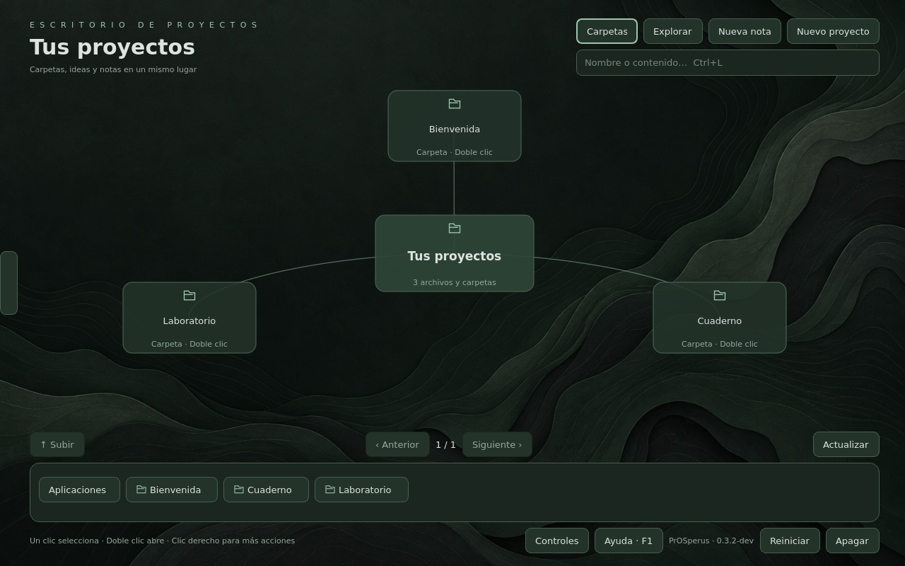

# ISO Live de prueba

**Estado al 29-10-2026:** arranque UEFI y sesión gráfica comprobados en QEMU/KVM
con dos CPU y 2 GiB de RAM, sin red. Se verificó crear un proyecto, crear y
guardar una nota y encontrarla por una palabra presente solo en su contenido.
Apagado ACPI comprobado. No se ha probado todavía en hardware físico ni en Boxes.



La receta incluye Fedora, el compositor Cage, PrOSperus y sus dependencias Qt/GIO.
Está orientada a máquinas virtuales x86_64 con UEFI y Secure Boot desactivado.
No incluye instalador ni persistencia: las notas y los ajustes de la sesión se
pierden al apagar. Usa los ejemplos ficticios para probarla.

## Construir

Requiere Podman rootless y conexión para descargar paquetes durante la
construcción. Desde la raíz del repositorio:

```bash
bash scripts/build-iso.sh
```

La salida es `out/iso/prosperus-live-x86_64.iso`, acompañada de su SHA-256,
inventario de paquetes y catálogo de arranque. Los contenedores de construcción
están limitados a dos CPU y 1 GiB de RAM; la compresión usa dos trabajadores y
256 MiB de buffers. Se necesita espacio adicional para exportar el sistema.
La base Fedora está fijada por digest, pero los paquetes proceden de los
repositorios disponibles al construir; no se promete reproducibilidad binaria.

## Probar en Boxes

1. Crea una máquina nueva desde el archivo ISO, con firmware UEFI.
2. Asigna dos CPU y 2 GiB de RAM. Cierra otras VM si falta memoria en el anfitrión.
3. La sesión entra directamente en PrOSperus sin instalar dependencias.
4. Crea un proyecto, una nota y comprueba búsqueda, guardado y copia de archivos.

La ISO no instala nada en el disco virtual. Su sistema comprimido permanece en
el medio de arranque; los cambios se escriben en una capa temporal en RAM.
No se necesita conexión a Internet para abrir PrOSperus.

## Prueba automatizable con QEMU

```bash
bash scripts/run-iso.sh
python3 scripts/vm-control.py --iso status
python3 scripts/vm-control.py --iso screenshot escritorio.ppm
python3 scripts/vm-control.py --iso poweroff
```

El arranque usa firmware OVMF y la unidad óptica, sin inyectar kernel ni initramfs
desde QEMU. La VM tiene 2 GiB, dos CPU, ninguna tarjeta de red ni disco del
anfitrión. VNC escucha en `127.0.0.1:5903`. Registro serie y socket de control
quedan en `out/iso/vm`; las capturas, en `out/iso/screenshots`.
El script comprueba la RAM disponible antes de arrancar y limita la memoria del
contenedor sin swap. Para una prueba reducida se puede ejecutar
`PROSPERUS_VM_MEMORY_MB=1024 bash scripts/run-iso.sh`.

La sesión de prueba conserva `selinux=0` y apagado permitido al usuario de la VM.
Esta configuración experimental no está preparada para instalación habitual.
La disponibilidad de controles de volumen/brillo depende de las herramientas y
dispositivos de la sesión; no se promete paridad completa con GNOME.

## Referencias de la receta

- [Arranque Live y overlays de dracut](https://dracut-ng.github.io/dracut.html).
- [El Torito y particiones EFI con xorriso](https://www.gnu.org/s/xorriso/man_1_xorrisofs_devel.html).
